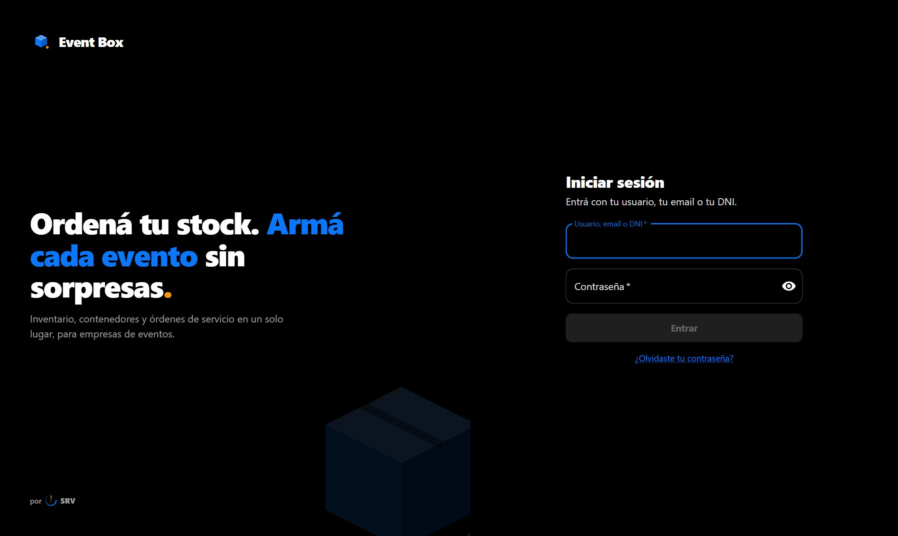
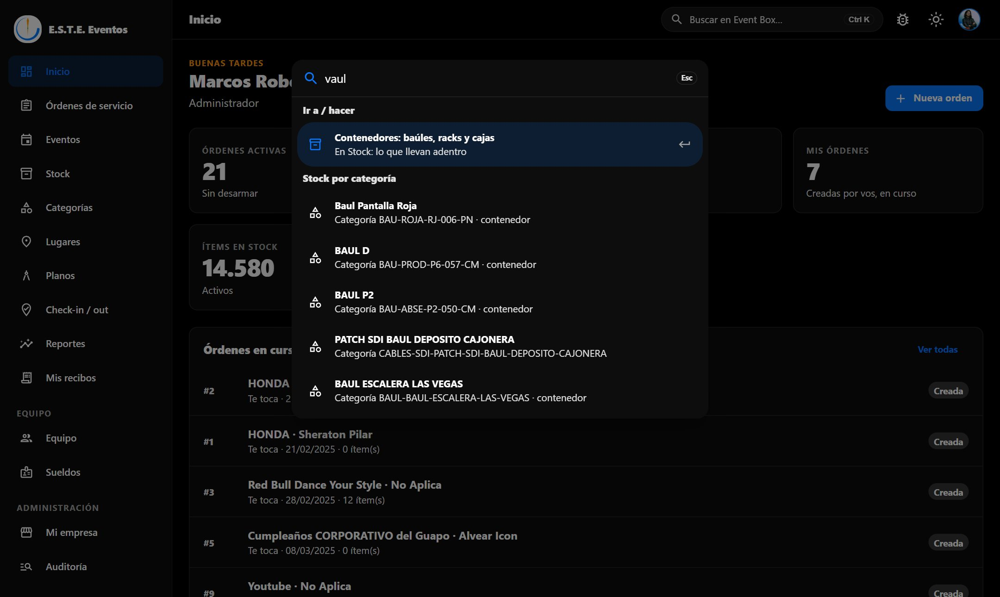
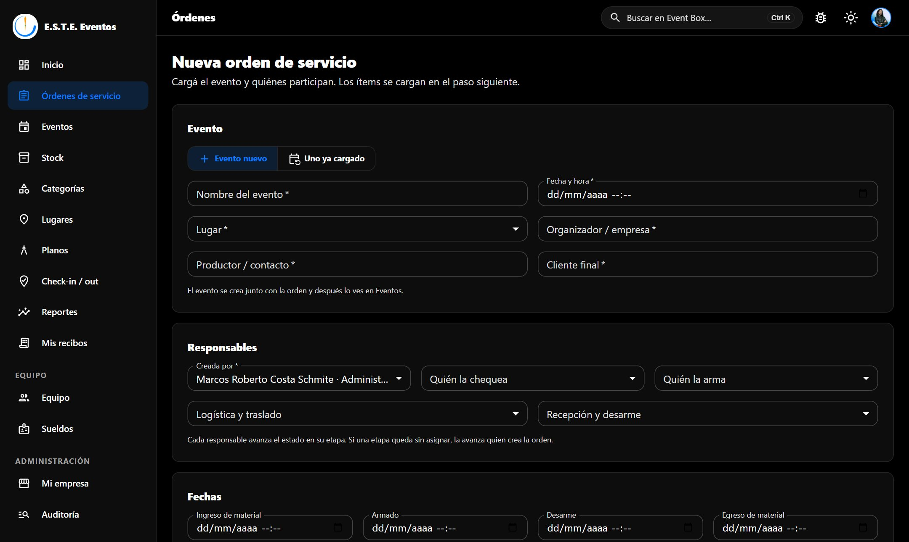
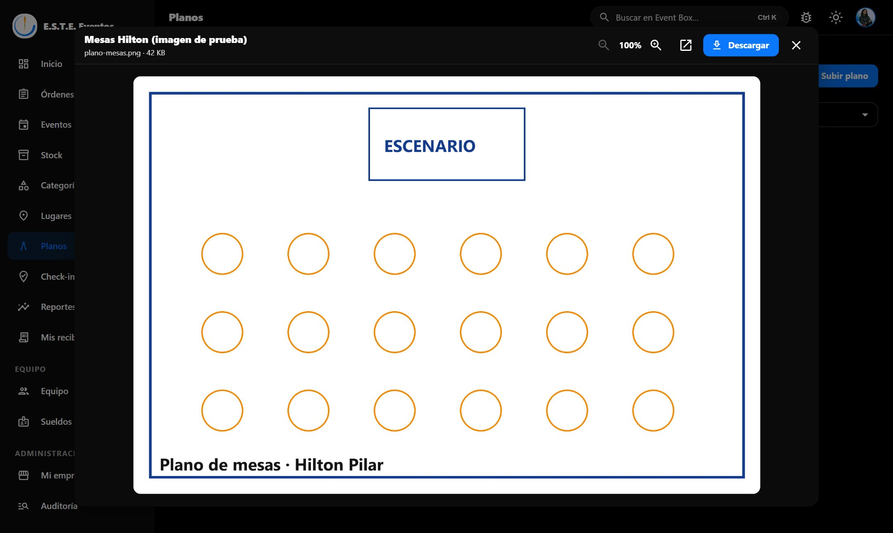
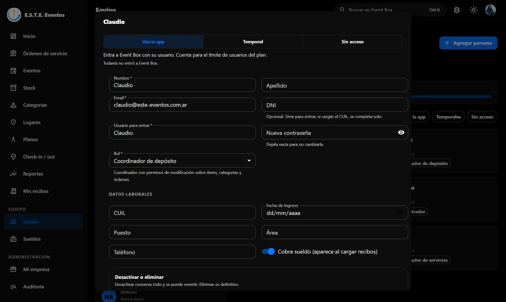
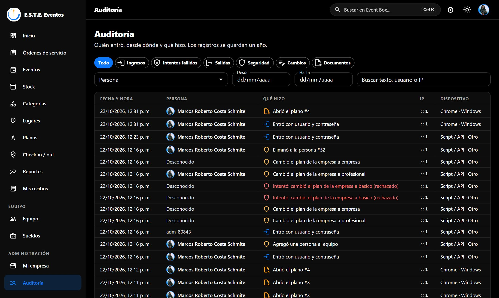
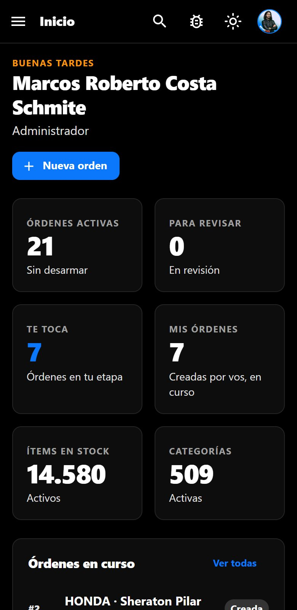
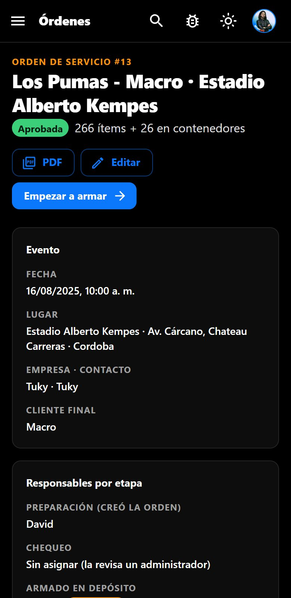
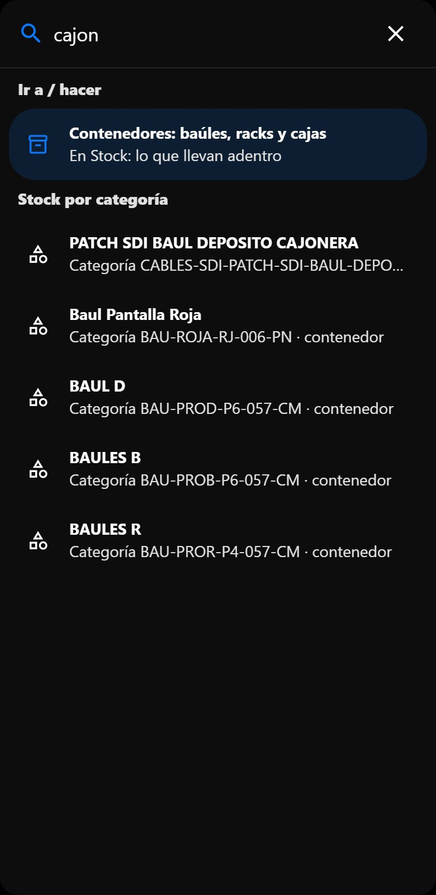

# Guía de uso de Event Box

Event Box ordena el depósito, los eventos y el equipo de una empresa de eventos. Esta guía recorre cada
pantalla. La versión en PDF, con planes, requisitos y alcances, está en
[Event-Box-Guia-de-uso-planes-y-alcances.pdf](Event-Box-Guia-de-uso-planes-y-alcances.pdf); la app móvil
se explica en [MOBILE.md](MOBILE.md).

> Las capturas son de una empresa de ejemplo en tema oscuro. Event Box también tiene tema claro (el sol de
> la barra superior) y todas las pantallas se adaptan al celular.

## Entrar

- Cada persona entra con su **usuario, su email o su DNI**. Al crearle el usuario le llega un mail con una
  **contraseña temporal** y un botón para entrar directo (o se la pasa el administrador si no tiene email); al entrar
  la primera vez elige una propia.
- **Blanquear contraseña** (en la ficha de la persona, en Equipo): le llega por mail una contraseña temporal nueva con
  el botón para entrar directo. La anterior deja de servir.
- *Olvidé mi contraseña* manda un link por mail que vale una hora y sirve una sola vez.
- **Mi perfil** (la foto, arriba a la derecha): nombre, email, DNI, foto y contraseña.
- **Llevar al celular** (al pie del menú) muestra un QR. Al escanearlo, el celular entra directo con tu
  usuario. Es de un solo uso y vence a los 5 minutos: no lo compartas.

## El buscador

Arriba a la derecha, o con **Ctrl + K** (⌘ + K en Mac). Sirve para llegar a cualquier parte sin saber
dónde está:

- **Pantallas y acciones**: "crear un nuevo ítem" abre *Agregar ítems al stock*; "cambiar contraseña",
  "subir plano", "agregar persona" o "roles" llevan a esa acción.
- **Datos de la empresa**: ítems por código, categorías, órdenes por número o por evento, eventos,
  lugares, personas y planos.
- **Entiende errores y otras palabras**: "vaul" o "boul" encuentran *baúl*; "cajón", "case" o "rack"
  también; "parlante" encuentra bafles.
- Cada persona ve solo lo que su rol le permite.

## Inicio

Cuántas órdenes están activas, cuántas esperan revisión, cuántas **te tocan a vos**, cuántas creaste, el
stock activo y las categorías. Abajo, las órdenes en curso con la etapa y quién tiene que avanzarla.

## Órdenes de servicio

La orden es el pedido de material para un evento. La lista se filtra por *En curso*, *Me toca a mí*,
*Creadas por mí*, *Para revisar*, *Para armar* o *Donde participo*, y por estado. **Columnas** deja elegir
qué ver; cada persona guarda su selección.

### Nueva orden

Como casi siempre el evento es nuevo, **se carga ahí mismo** (nombre, fecha, lugar, organizador,
productor y cliente) y se crea junto con la orden. Si es para un evento ya cargado, se elige en *Uno ya
cargado*: muestra los próximos, y los que ya pasaron tildando la opción.

### Una orden

- **Etapa actual** y quién la avanza. El botón principal aparece solo para quien le toca.
- **Material**: por categoría y cantidad desde el stock libre, o un ítem puntual por código.
- **PDF** con el logo de la empresa.
- **Pasar material a otro evento** (Profesional y Empresa): desde *En el evento* en adelante, sin volver
  al depósito.

Flujo: creada → en revisión → aprobada (o rechazada) → armando → lista → despachada → en el evento →
volviendo → recibida → revisando material → desarmada. **Nadie aprueba su propia orden**.

## Eventos y lugares

Cada evento tiene nombre, lugar, fecha, organizador, productora y cliente final. **Duplicar** (Profesional
y Empresa) copia el evento y puede armar una orden nueva con la misma cantidad de ítems por categoría.
**Lugares** guarda salones y predios; con coordenadas (*Estoy acá* o desde Google Maps) sirven para el
check-in.

## Stock y categorías

Cada unidad física es un **ítem** con un código único; el comienzo del código es el de su categoría.

- **Agregar ítems**: categoría y cantidad; los códigos se asignan solos.
- **Importar CSV**: `nombre, descripcion, codigo, tipo, unidad, valor, peso, es_almacenable, es_contenedor, cantidad`.
- **Contenedores** (baúles, racks, cajas): contenido fijo o ítems solo para una orden; pueden ir uno
  dentro de otro.
- **Categorías**: código, nombre, tipo, unidad, valor y peso. Desactivar una categoría desactiva sus ítems.

## Planos (Profesional y Empresa)

- **Ver** abre el plano al instante dentro de la app, con el avance en porcentaje mientras baja. Las
  imágenes tienen zoom; en la computadora el PDF usa el visor del navegador y en el celular se muestra
  página por página.
- **Descargar** muestra el avance en el botón de ese plano; los demás siguen disponibles.
- Lo ya abierto queda en memoria durante la sesión: volver a abrirlo es instantáneo.

## Check-in / out (Empresa)

Registra cuándo el material **llega** y cuándo **se retira**, con la ubicación. Dentro de 300 m del lugar
queda *En el lugar*; si no, avisa la distancia y se puede registrar igual. En la app móvil está en cada orden.

## Reportes (Empresa)

Para los últimos 3, 6, 12 o 24 meses: uso del stock, ítems nunca usados, ciclo promedio de una orden,
órdenes por mes y por estado, categorías e ítems más usados, lugares, quién pide más y check-ins.

## Equipo

Todas las personas de la empresa, con el uso del plan arriba. Cada tarjeta muestra el rol y el **último
ingreso** (o si nunca entró).

| Acceso | Entra a la app | Cuenta como usuario | Para qué |
|---|---|---|---|
| **Usa la app** | Sí, con su rol | Sí | El equipo fijo |
| **Temporal** | De 1 a 10 días, renovable | No (tope de temporales por plan) | Un evento, un reemplazo |
| **Sin acceso** | No | No | Personal que solo cobra (firma en papel) |

En la ficha: acceso, datos, DNI, contraseña, rol, datos laborales y el último ingreso con su IP.

- **Desactivar**: no entra ni cuenta para el plan; conserva todo. Se revierte.
- **Eliminar definitivamente** (solo administradores): borra el usuario y sus recibos.

### Roles y permisos

Cada rol dice qué se puede **ver, crear, editar y borrar** en cada módulo. Los que el plan no incluye
aparecen con candado. El rol **Administrador** es fijo. Nadie cambia su propio rol ni su acceso, y la
empresa siempre conserva al menos un administrador.

## Sueldos (Profesional y Empresa)

Event Box no liquida sueldos: distribuye los recibos en PDF y registra la firma. La persona los ve en
**Mis recibos** (también desde el celular) y firma en conformidad o en disconformidad. Para quien no usa
la app, **Firmado en papel**. Un recibo firmado ya no se modifica.

## Mi empresa (administrador)

Abono del mes, datos y logo de la empresa, y **Planes**: comparación, uso y cambio de plan. Si la empresa
tiene un **acuerdo especial** con SRV, el plan queda fijo hasta la fecha pactada; para cambiarlo, hay que
hablar con SRV.

## Auditoría (equipo de SRV)

Quién entró, desde dónde y qué hizo: ingresos con fecha, IP y dispositivo; intentos fallidos; salidas;
acciones de seguridad (contraseñas, roles, accesos); cambios y documentos abiertos. La ve solo el equipo de
SRV, con los registros de todas las empresas. Se filtra por empresa, tipo, fechas o texto (persona, acción o
IP). Nunca se guardan contraseñas y los registros se conservan un año.

## En el celular

| Inicio | Una orden | Buscador |
|---|---|---|
|  |  |  |

La web se adapta al celular y además hay app para iOS y Android ([MOBILE.md](MOBILE.md)).

## Si algo falla

- **Reportar un problema** (barra superior): llega a SRV, con captura opcional.
- Si una pantalla se rompe, aparece **Recargar página** y **Reportar el problema** (el detalle técnico se
  adjunta solo).
- Cuando sale una versión nueva, la app se actualiza sola al cambiar de pantalla.
