# Guía de uso de Event Box

Event Box ordena el depósito, los eventos y el equipo de una empresa de eventos. Esta guía
recorre cada pantalla. La versión en PDF, con planes, requisitos y alcances, está en
[Event-Box-Guia-de-uso-planes-y-alcances.pdf](Event-Box-Guia-de-uso-planes-y-alcances.pdf);
la app móvil se explica en [MOBILE.md](MOBILE.md).

> Las capturas son de una empresa de ejemplo en tema oscuro. Event Box también tiene tema claro
> (el sol/luna de la barra superior) y todas las pantallas se adaptan al celular.

## Entrar

Cada persona entra con el usuario y la contraseña que le dio el administrador de su empresa. Si
se olvidó la contraseña, *Olvidé mi contraseña* manda un link por mail que vale una hora.

Desde **Mi perfil** (la foto, arriba a la derecha) se cambian el nombre, el email, la foto de perfil y
la contraseña.

## Inicio

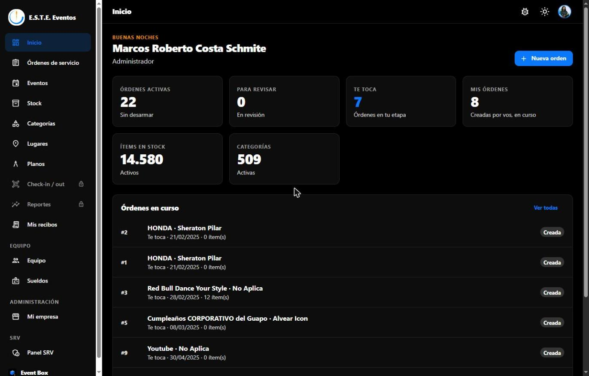

Un vistazo al día: cuántas órdenes están activas, cuántas esperan revisión, cuántas **te tocan a vos**
(sos el responsable de la etapa en la que están), cuántas creaste, el stock activo y las categorías.
Abajo, las órdenes en curso, con la etapa y quién tiene que avanzarla.

## Órdenes de servicio

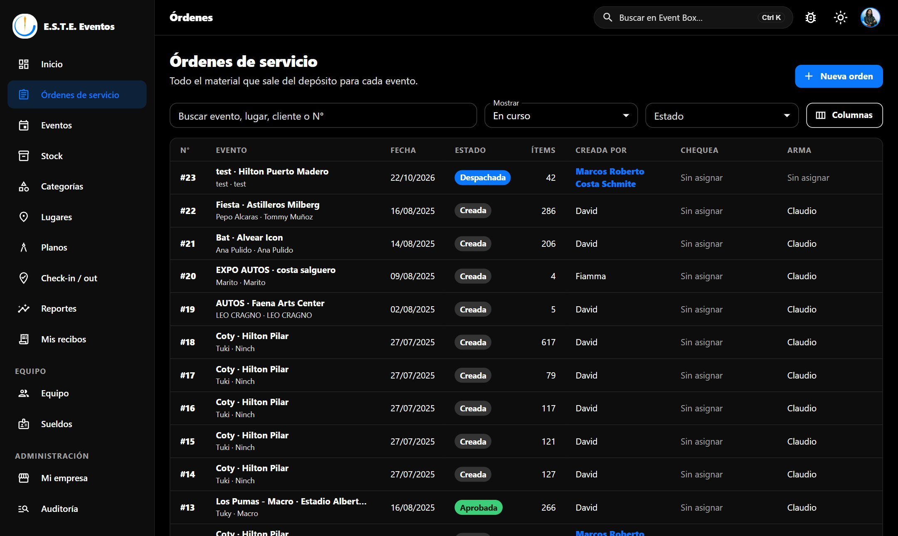

La orden es el pedido de material para un evento. La lista se filtra por *En curso*, *Me toca a mí*,
*Creadas por mí*, *Para revisar*, *Para armar* o *Donde participo*, por estado, y se busca por evento,
lugar, cliente o número.

El botón **Columnas** permite ocultar las que no usás y agregar otras (lugar, ciudad, organizador,
cliente final, fechas de salida y vuelta, logística, recepción, observaciones). Cada persona guarda su
propia selección.

### Una orden

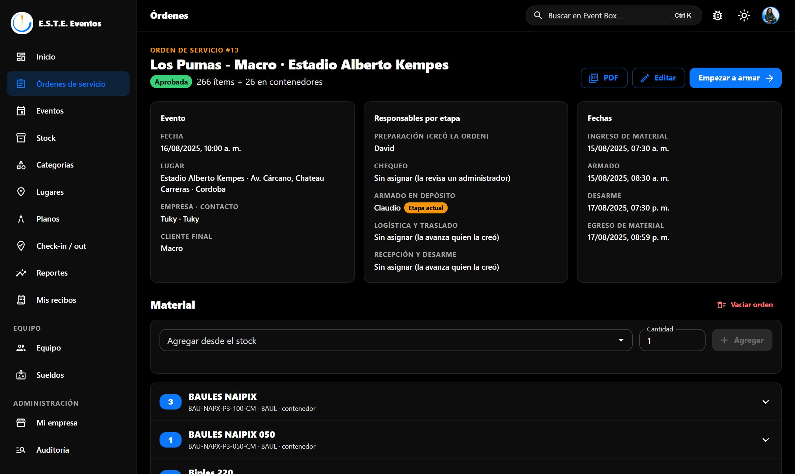

- **Etapa actual** y quién la avanza. El botón de la derecha (por ejemplo *Enviar a revisión*) es el
  paso siguiente; aparece solo para quien le toca.
- **Responsables por etapa**: quien creó la orden, quien la chequea, quien la arma, logística y
  recepción. Se reasignan con *Editar* durante todo el recorrido.
- **Fechas** de ingreso, armado, desarme y egreso del material.
- **Material**: se agrega por categoría y cantidad desde el stock libre, o un ítem puntual por código.
  Los contenedores muestran lo que llevan adentro. Un ítem que ya está en otra orden en curso no se
  puede cargar.
- **PDF**: la orden completa con el logo de la empresa, para imprimir o mandar.
- **Pasar material a otro evento** (Profesional y Empresa): desde *En el evento* en adelante, todo
  el material pasa directo a otra orden, sin volver al depósito.

El flujo es: creada → en revisión → aprobada (o rechazada → en revisión) → armando → lista →
despachada → en el evento → volviendo → recibida → revisando material → desarmada. Al desarmar, los
ítems vuelven a quedar libres. **Nadie aprueba su propia orden**: si no hay chequeador asignado, la
revisa un administrador.

## Eventos y lugares

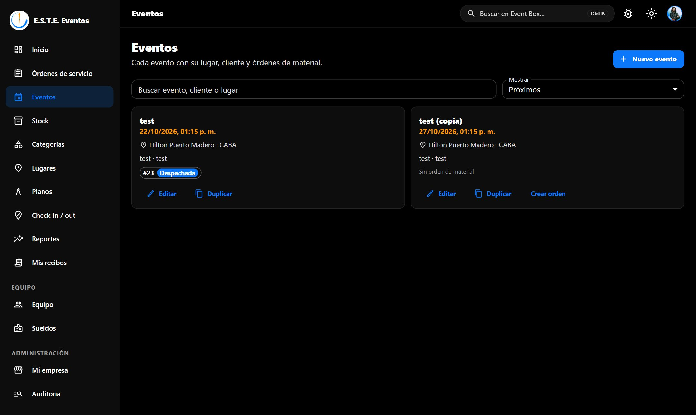

Cada evento tiene nombre, lugar, fecha, organizador, productora y cliente final, y desde su tarjeta
se abre o se crea su orden. **Duplicar** (Profesional y Empresa) copia el evento y, si se pide, arma
una orden nueva con la misma cantidad de ítems por categoría, tomados del stock libre.

**Lugares** son los salones, estadios y predios, para no cargarlos cada vez.

## Stock y categorías

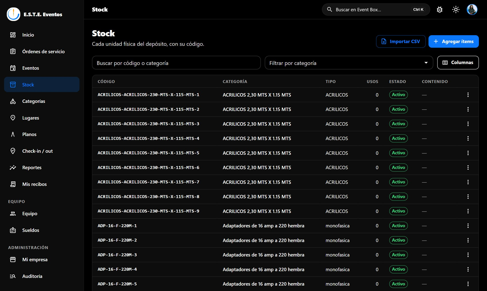

Cada unidad física es un **ítem** con un código único, por ejemplo `HDMI-12`: el prefijo es el código
de la categoría. Se buscan por código o categoría, se filtran por categoría y se desactivan si están
rotos o en reparación (no se borran: quedan fuera de las órdenes).

- **Agregar ítems**: elegís la categoría y la cantidad; los códigos se asignan solos.
- **Importar CSV**: para cargar mucho stock de una vez. Columnas: `nombre, descripcion, codigo, tipo,
  unidad, valor, peso, es_almacenable, es_contenedor, cantidad`. Se puede guardar desde Excel.
- **Contenedores** (baúles, racks, cajas): pueden tener **contenido fijo**, que viaja siempre con
  ellos, o recibir ítems solo para una orden. Pueden ir uno dentro de otro; los dos tipos de contenido
  se vacían de una vez.
- **Columnas**: igual que en órdenes, podés ocultar el código y agregar unidad, valor, peso o responsable.

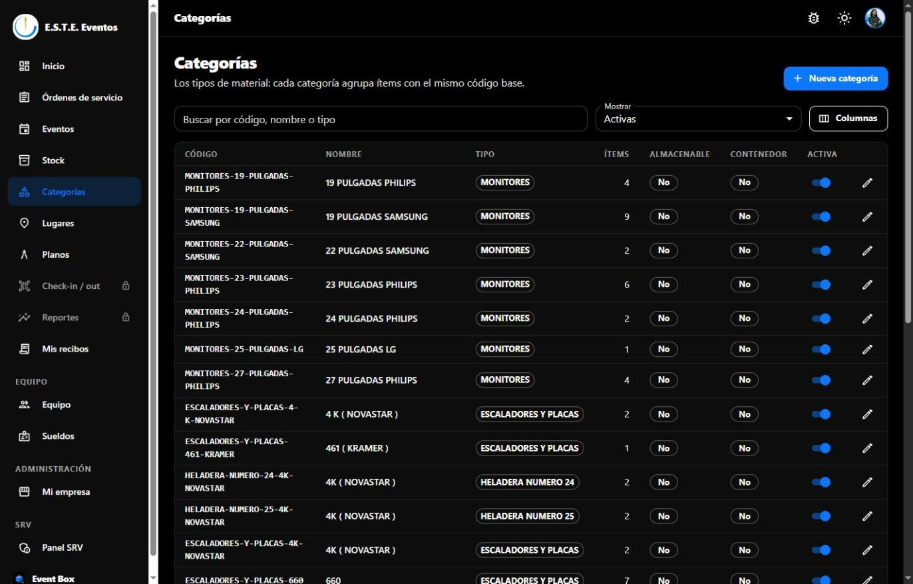

Las **categorías** agrupan ítems del mismo tipo: código (sin espacios), nombre, tipo, unidad, valor y
peso, y si son almacenables o contenedores. Desactivar una categoría desactiva sus ítems.

## Planos

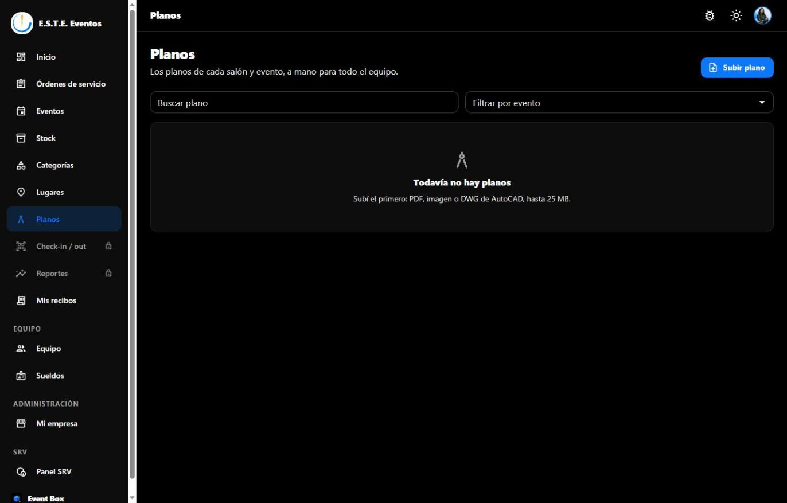

Con el plan Profesional o Empresa, los planos del evento se suben en PDF, imagen o DWG y los ve
todo el equipo desde el navegador o el celular. Son privados de la empresa.

## Check-in / out (plan Empresa)

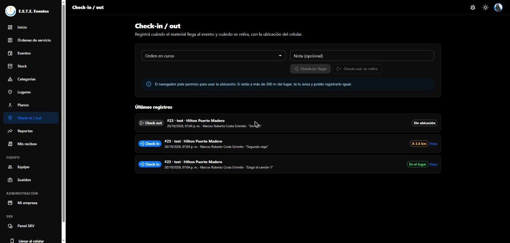

Registrá cuándo el material **llega al evento** y cuándo **se retira**, con la ubicación del celular o del
navegador. Elegís la orden en curso, agregás una nota si hace falta y tocás *Check-in: llegó* o
*Check-out: se retira*.

- Si el lugar del evento tiene coordenadas (se cargan en **Lugares**, con *Estoy acá* o copiándolas
  de Google Maps), se calcula la distancia: dentro de 300 m queda **En el lugar**; si estás más lejos,
  te avisa cuánto y podés registrarlo igual como *fuera del lugar*.
- Cada registro guarda quién, cuándo, la distancia y un link al mapa.
- En la app móvil está en el detalle de cada orden, con el GPS del teléfono.

## Reportes (plan Empresa)

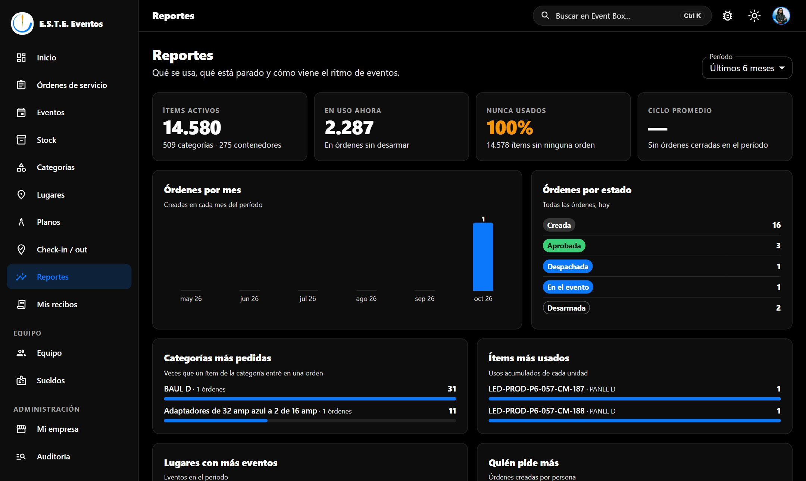

Qué se usa y qué está parado, para los últimos 3, 6, 12 o 24 meses: ítems activos, cuántos están en
uso ahora, cuántos nunca se usaron, ciclo promedio de una orden (de creada a desarmada), órdenes por
mes y por estado, categorías más pedidas, ítems más usados, lugares con más eventos, quién pide más y
los check-ins del período.

## Equipo

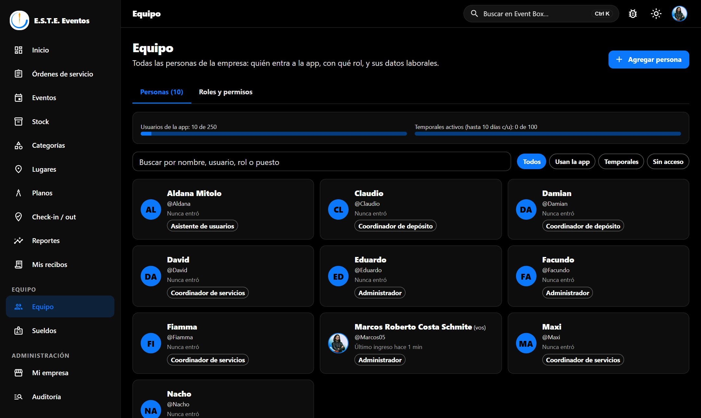

Todas las personas de la empresa en un solo lugar. Arriba, cuántos usuarios de la app y cuántos
accesos temporales hay frente al límite del plan. Cada persona tiene un tipo de acceso:

| Acceso | Entra a la app | Cuenta como usuario del plan | Para qué |
|---|---|---|---|
| **Usa la app** | Sí, con su rol | Sí | El equipo fijo |
| **Temporal** | De 1 a 10 días; después se corta solo. Se renueva las veces que haga falta | No (hay un tope de temporales activos por plan) | Personal de un evento, un reemplazo. No puede ser administrador |
| **Sin acceso** | No | No | Eventuales o personal que solo cobra. Firma los recibos en papel. Requiere el módulo de sueldos |

Al tocar a una persona se editan su acceso, sus datos, su usuario, su contraseña, su rol y, con el
módulo de sueldos, sus **datos laborales** (CUIL, puesto, área, fecha de ingreso, teléfono, si cobra
sueldo). Abajo de la ficha:

- **Desactivar**: no entra ni cuenta para el plan, pero conserva sus órdenes, recibos y datos. Se
  revierte con *Volver a activar*.
- **Eliminar definitivamente** (solo administradores): borra el usuario y sus recibos. Las órdenes
  que creó quedan sin creador y el material a su cargo sin responsable.

### Roles y permisos

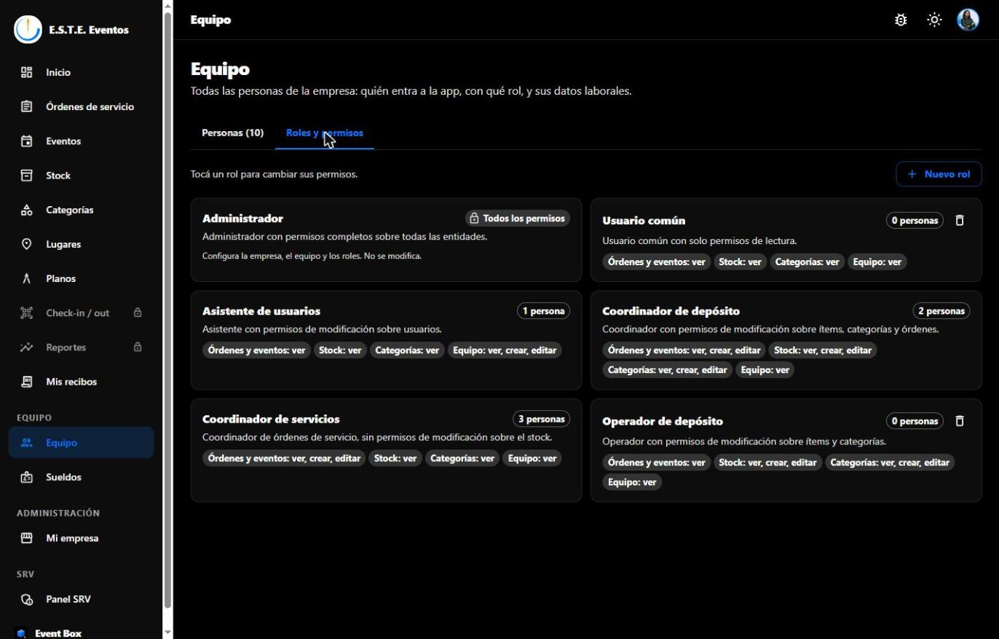

Cada empresa define sus roles. Un rol dice qué se puede **ver, crear, editar y borrar** en órdenes,
eventos, lugares, stock, categorías, equipo, planos, sueldos, check-in y reportes. Los módulos que
el plan no incluye aparecen con candado: el permiso se guarda y empieza a valer al cambiar de plan.

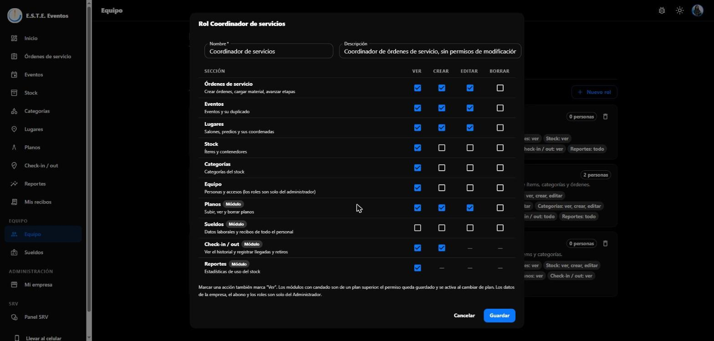 Vienen roles de fábrica para empezar y se pueden crear otros
(por ejemplo, *Chofer*). El rol **Administrador** es fijo y tiene todos los permisos.

Por seguridad: los roles los modifica solo un administrador; solo un administrador puede dar el rol
Administrador o modificar a otro administrador; nadie cambia su propio rol ni su propio acceso; y la
empresa siempre conserva al menos un administrador.

## Sueldos

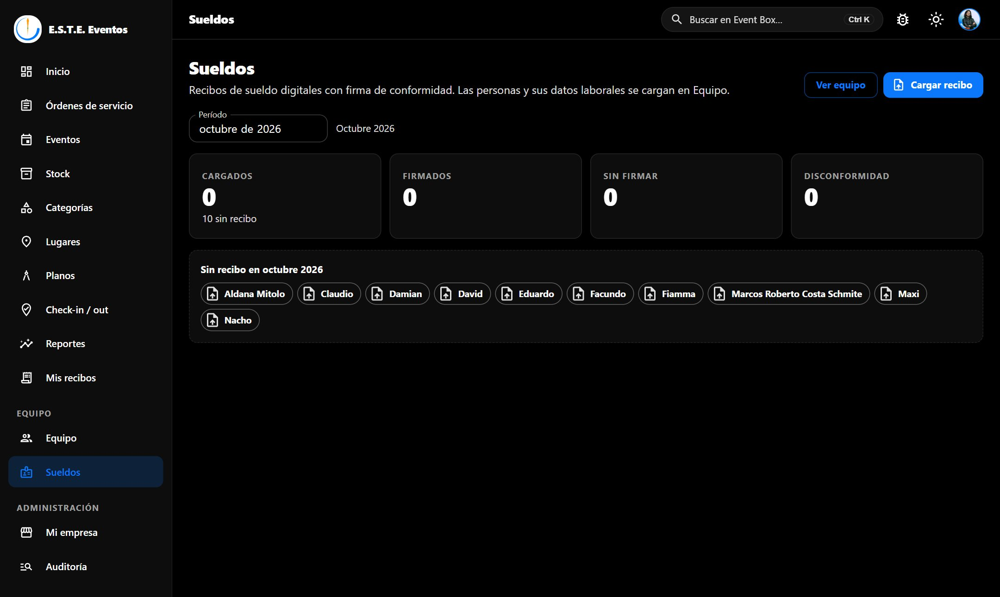

Recibos de sueldo digitales (Profesional y Empresa). Event Box no liquida sueldos: distribuye los
recibos en PDF que ya generó la empresa y registra la firma.

1. **Cargar recibo**: persona, período, tipo (mensual, aguinaldo, vacaciones, liquidación final, otro),
   bruto y neto opcionales, y el PDF. La persona recibe un mail con el link.
2. La persona lo abre en **Mis recibos** (pensado para el celular y disponible en la app) y lo firma
   **en conformidad** o **en disconformidad** con el motivo. La firma queda con fecha y hora.
3. Para quien no usa la app, el botón **Firmado en papel** deja constancia.
4. El panel del mes muestra cuántos recibos hay, cuántos firmados, cuántos pendientes, cuántos en
   disconformidad y a quién le falta el recibo.

Un recibo sin firmar se puede reemplazar o borrar; uno firmado ya no se modifica.

## Mi empresa (administrador)

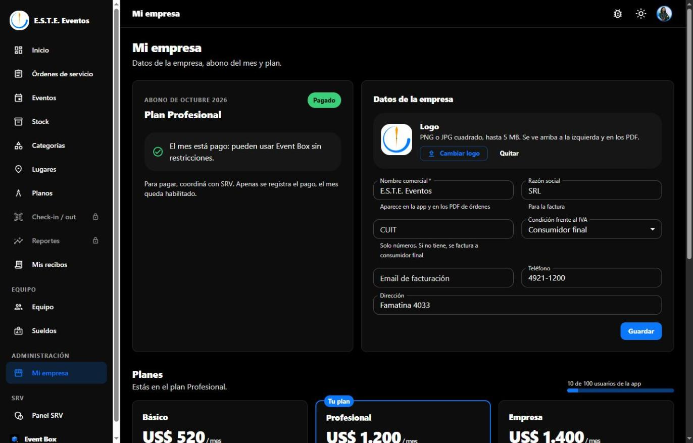

- **Abono del mes**: plan, si está pagado o pendiente, el monto en pesos al dólar blue del día y el
  vencimiento (el día 10). Si no se paga, desde el 11 la app se bloquea y solo el administrador entra
  a ver el abono; los datos no se borran.
- **Datos de la empresa** y **logo** (aparece arriba a la izquierda y en los PDF).

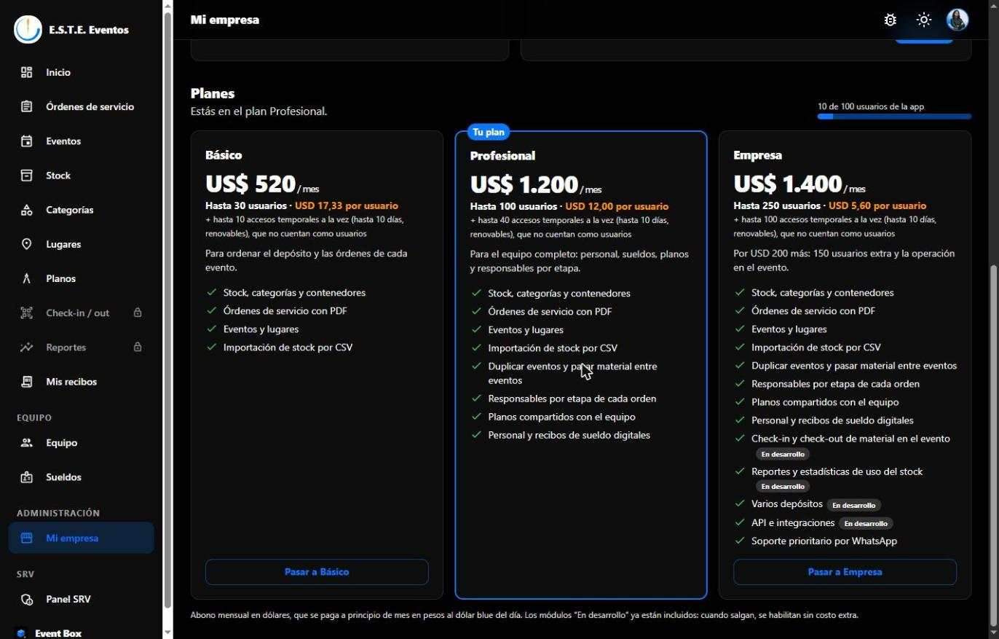

- **Planes**: la comparación de Básico, Profesional y Empresa, el uso de usuarios frente al límite y
  el cambio de plan. El precio nuevo rige desde el próximo abono. No se puede bajar a un plan con
  menos usuarios de los que ya tienen acceso.

## Llevar Event Box al celular

El botón **Llevar al celular**, al pie del menú, muestra un QR para abrir el sitio desde el teléfono.
En el celular, el mismo botón explica cómo agregarla a la pantalla de inicio: queda con el ícono de
Event Box y abre a pantalla completa, como una app. (La app nativa, con GPS para el check-in, es
aparte: ver [MOBILE.md](MOBILE.md).)

## Reportar un problema

El ícono de la barra superior abre un formulario para contarle a SRV un error, una idea o una consulta,
con captura opcional. Llega a info@wearesrv.com.

## Panel SRV (solo el equipo de SRV)

Alta de empresas con su primer administrador, plan y precio (de lista o especial), registro de
pagos, suspensión y reactivación, y los reportes que mandan los usuarios.

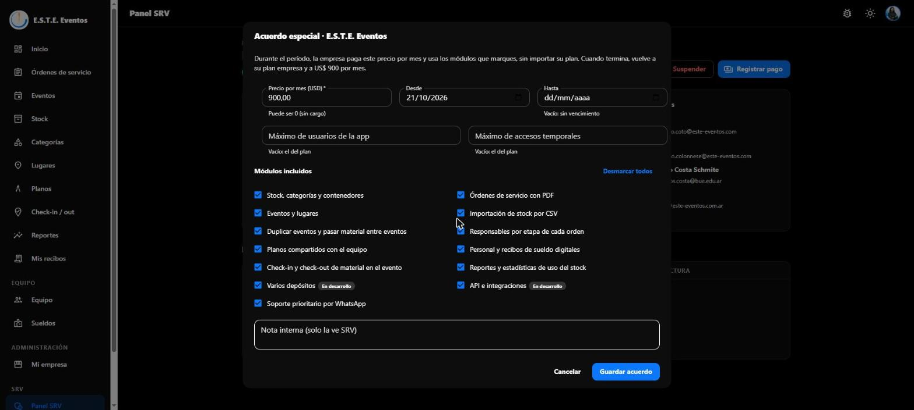

**Acuerdo especial**: para una empresa, por un período, un precio propio por mes, los módulos que
SRV decida (sin importar el plan) y límites propios. Por ejemplo, "hasta el año que viene, USD 400
por mes con todo incluido". Al vencer, la empresa vuelve sola a su plan y a su precio de lista.
